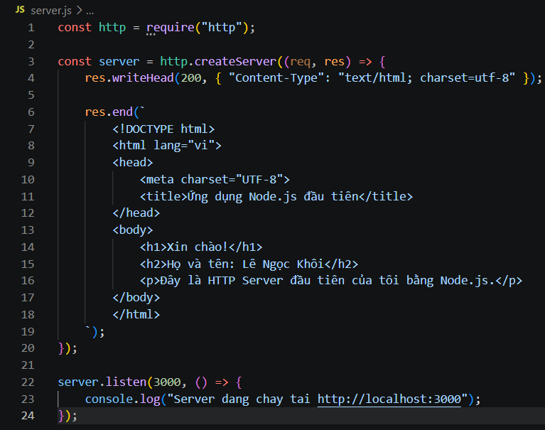
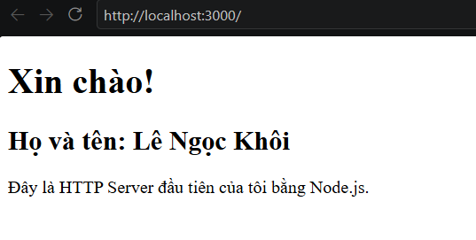

# BÀI 2: ỨNG DỤNG NODE.JS ĐẦU TIÊN

## 1. Mục tiêu
- Tạo HTTP Server bằng Node.js thuần.
- Sử dụng module http có sẵn của Node.js.
- Truy cập server thông qua localhost:3000.
- Hiển thị trang HTML chứa tên sinh viên.

## 2. Công nghệ sử dụng
- Ngôn ngữ: JavaScript.
- Môi trường chạy: Node.js.
- Công cụ lập trình: Visual Studio Code.

## 3. Cách chạy chương trình

Mở Terminal tại thư mục chứa file server.js và chạy lệnh:

node server.js

Sau đó mở trình duyệt và truy cập:

http://localhost:3000

## 4. Kết quả thực hiện

Server chạy thành công tại cổng 3000 và trả về trang HTML hiển thị thông tin sinh viên.

## 5. Hình ảnh minh chứng

### 5.1. Mã nguồn và Terminal

### 5.2. Kết quả trên trình duyệt

## 6. Kết luận

Em đã tạo và chạy thành công HTTP Server đầu tiên bằng Node.js thuần. Server có thể tiếp nhận yêu cầu từ trình duyệt tại localhost:3000 và trả về nội dung HTML chứa thông tin sinh viên.